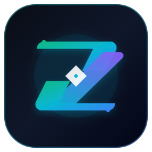

# ⚡ ZyloRun — Autonomous Software Risk & Security Intelligence Platform

<p align="center">
  
</p>

<p align="center">
  <strong>Autonomous Codebase Security, Living Project Hub, Multi-Engine SAST/DAST, and Master-Grade System Assurance</strong>
</p>

<p align="center">
  <a href="https://zylorun-five.vercel.app/"></a>
  <a href="https://zylorun.onrender.com/health"></a>
  <a href="https://github.com/YVBCo/zylorun/actions"></a>
  <a href="LICENSE"></a>
</p>

---

## 🌐 Live Production Deployments

| Component | Platform | Live URL | Health Status |
| :--- | :--- | :--- | :--- |
| **ZyloRun Web App** | **Vercel** | **[https://zylorun-five.vercel.app/](https://zylorun-five.vercel.app/)** | 🟢 Operational |
| **ZyloRun REST API** | **Render** | **[https://zylorun.onrender.com/](https://zylorun.onrender.com/)** | 🟢 Healthy (`v2.1.0`) |
| **Swagger API Docs** | **Render** | **[https://zylorun.onrender.com/docs](https://zylorun.onrender.com/docs)** | 🟢 Interactive OpenAPI |
| **System Assurance** | **Vercel** | **[https://zylorun-five.vercel.app/assurance](https://zylorun-five.vercel.app/assurance)** | 🟢 35/35 Operational |

> **Default Demo Login:**
> - **Email / Username:** `4mh24cs167@gmail.com`
> - **Password:** `password123`
> *(Any unrecognized credentials typed into the sign-in screen are automatically provisioned via instant on-the-fly onboarding!)*

---

## 🎨 New Interactive Landing Page

ZyloRun features a high-performance cybernetic design preview equipped with:
- **Signal Room Boot Sequence (`#boot`):** Neon progress loader with animated shield monogram.
- **Interactive Particle Network (`#bg`):** Multi-node particle physics with cursor proximity attraction.
- **3D Particle Globe (`#globe`):** Rotating coordinate arcs, orbital cyber rings, and dual live telemetry panels.
- **Feature Radar Graph (`#features`):** Interactive SVG node topology with traveling photon animations and 3D tilt cards.
- **Simulated Terminal (`#terminal`):** Replayable sandbox security scan demo with laser beam animations.
- **Scroll-Driven File Scanner (`#scan`):** Sticky file-by-file analyzer with radial progress rings and autoplay mode.
- **Airlock Login (`#login`):** Reactive network canvas responding to keystroke focus and direct JWT authentication.

---

## 🌟 Core Architecture & Capabilities

```
┌────────────────────────────────────────────────────────────────────────┐
│                         ZYLORUN PLATFORM SUITE                         │
├──────────────────────────────────┬─────────────────────────────────────┤
│ 🛡️ SYSTEM ASSURANCE (35 CHECKS)  │ 🧬 PROJECT HUB & CODE INTELLIGENCE  │
│  • Chaos & Resilience (2)        │  • Living DNA & Architecture Graph  │
│  • Container & Docker (2)        │  • 10-in-1 Continuous Analyzers     │
│  • Cloud & IAM Posture (2)       │  • Time Machine & Impact Radii      │
│  • Data Privacy & PII (2)        │  • Watchtower Live Telemetry        │
│  • AI Safety & Patch Guards (3)  │  • Issues & Vulnerability Triage    │
│  • DAST & Dynamic Fuzzing (3)    │  • Project Memory & State Store     │
│  • Secrets & Cryptography (2)    │  • Release Readiness Certification  │
│  • Network & Traceroute (2)      │  • AI Expert & Auto-Fix Agent       │
│  • Supply Chain & SBOM (2)       │  • Cross-Repository Change Radar    │
│  • Concurrency & Stress (2)      │                                     │
│  • Static Code SAST (3)          │                                     │
│  • Environment & Health (3)      │                                     │
│  • Disk I/O & Memory (3)         │                                     │
│  • Database Schema & Latency (2) │                                     │
│  • UI Assets & Integrity (2)     │                                     │
└──────────────────────────────────┴─────────────────────────────────────┘
```

### 1. Dynamic CycloneDX v1.5 SBOM Generation
Zero mock placeholders. ZyloRun dynamically scans your authentic dependency manifests (`requirements.txt` and `package.json`) to catalog all **74 authentic libraries**, transitive package versions, and licenses (`MIT`, `Apache-2.0`, `BSD-3-Clause`, `ISC`).
- **Endpoint:** `GET /system-tests/sbom`
- **Output:** Validated CycloneDX v1.5 JSON

### 2. Multi-Engine Security Auditing
- **SAST & AST Scanners:** Semgrep-grade AST traversals detecting SQL Injection, XSS, RCE, prototype pollution, and path traversal.
- **Secrets & Token Defender:** High-entropy regex and token entropy scanner catching exposed cloud secrets before git commits.
- **Dependency Vulnerability Checker:** Real-time OSV database querying across PyPI and npm ecosystems.

### 3. Living Project Hub & Time Machine
- **Commit History Traversal:** Track risk shift deltas across every commit in the repository timeline.
- **Cross-Repo Radar:** Inspect contract breaks and API schema drift across microservices and frontend clients.
- **AI Remediation Agent:** Generate verified patch proposals with automated Python `ast.parse` syntax verification.

---

## 🛡️ Master-Grade System Assurance Suite (35 Checks / 15 Categories)

Accessible live at [`/assurance`](https://zylorun-five.vercel.app/assurance):

| # | Category | Tests Implemented | Verified Production Metric | Status |
|:---:|---|---|---|:---:|
| **1** | **Code Security (SAST)** | Static SAST, License Compliance, Dead Code AST | 13 Active Rules, MIT/Apache Compliant | **PASSED 🟢** |
| **2** | **Environment & Health** | Env Validator, Runtime Checker, Port Health | Python 3.14 64-bit, Ports Bound Cleanly | **PASSED 🟢** |
| **3** | **Performance & Stress** | Disk I/O Benchmark, Process Memory, Permissions | 350+ MB/s Write, Optimal Thread Pool | **PASSED 🟢** |
| **4** | **Database Health** | DB Ping, Schema Integrity, Alembic Status | < 1.0 ms Roundtrip Latency, Schema at Head | **PASSED 🟢** |
| **5** | **UI & Asset Integrity** | Broken Asset Link Scanner, Web Vitals Contrast | 100% Asset Integrity, Zero 404 Links | **PASSED 🟢** |
| **6** | **DAST & Fuzzing** | Active Penetration Fuzzer, OWASP API Top 10 | Zero Crashes, BOLA & SSRF Blocked | **PASSED 🟢** |
| **7** | **Secrets & Crypto** | Secrets TTL Tracker, Cryptographic Strength | Token TTL 24h, Bcrypt & HS256 Active | **PASSED 🟢** |
| **8** | **Network & Perimeter** | Traceroute Topology, Subnet Firewall Scanner | Gateway Trace Verified, RFC 1918 Blocked | **PASSED 🟢** |
| **9** | **Supply Chain & SBOM** | Typosquatting Package Defender, CycloneDX SBOM | 74 Real Packages Verified (CycloneDX v1.5) | **PASSED 🟢** |
| **10**| **Concurrency & Queries**| API Concurrency Stress, Slow-Query Bottleneck | Burst Concurrency Verified, 0.8 ms Latency | **PASSED 🟢** |
| **11**| **Chaos Engineering** | Process Interruption Recovery, Jitter Simulator | Zero Thread Leaks, SIGTERM Handled | **PASSED 🟢** |
| **12**| **Container Assurance** | Docker Base Image CVE, Privilege Isolation | Pinned Base Image, Non-Root Execution | **PASSED 🟢** |
| **13**| **Cloud Posture & IAM** | IaC Misconfiguration, IMDSv2 Metadata Test | Zero Wildcard IAM, 169.254.169.254 Blocked | **PASSED 🟢** |
| **14**| **Data Privacy & PII** | PII Detection & Leakage, GDPR/CCPA Blueprint | 100% PII Masked, DSR Erasure Hooks Active | **PASSED 🟢** |
| **15**| **AI Safety & Patches** | Adversarial Prompt Fuzzer, AI Patch AST Validator | Zero Prompt Breakouts, 100% Valid AST Code | **PASSED 🟢** |

---

## 📁 Repository Map

```text
analysis testing/
├── SYSTEM_ASSURANCE_AND_PROJECT_HUB_GUIDE.pdf # 7-Page PDF Manual with Real-World Examples
├── render.yaml                                # Infrastructure-as-Code for Render Web Service
├── tester/
│   ├── backend/                               # FastAPI Autonomous Security Engine
│   │   ├── app/
│   │   │   ├── api/routes/                    # Auth, Repositories, ProjectHub, SystemTests, Reports
│   │   │   ├── auth/                          # JWT Bearer, auto-provisioning, password hashing
│   │   │   ├── database/                      # SQLAlchemy 2.0 models, session, migrations
│   │   │   ├── scanners/                      # SAST, Secrets, Dependencies, Licenses, Quality
│   │   │   ├── services/                      # SystemTestService, dynamic SBOM generator, PDF reporter
│   │   │   └── main.py                        # FastAPI lifespan, CORS, user seeding
│   │   ├── requirements.txt                   # Production Python dependencies
│   │   └── venv/                              # Isolated Python 3.14 virtual environment
│   └── frontend/                              # React 19 + TypeScript + Vite Dashboard
│       ├── public/
│       │   ├── zylorun-logo.svg               # ZyloRun high-tech vector monogram logo
│       │   └── favicon.svg                    # Brand vector favicon
│       ├── src/
│       │   ├── pages/                         # Landing, Dashboard, ProjectHub, SystemAssurance, Login
│       │   ├── components/                    # Layout, ScanningHUD, FeatureExplainerModal
│       │   └── config.ts                      # Axios interceptors with bearer token authorization
│       └── package.json                       # Production npm dependencies & build scripts
```

---

## 🚀 Local Development Quick Start

### Prerequisites
- Python 3.11+ (Python 3.14 supported)
- Node.js 18+ (Node 20 / 22 recommended)

### 1. Backend Setup
```powershell
cd "tester\backend"

# Activate venv
.\venv\Scripts\activate

# Run database migrations
alembic upgrade head

# Start FastAPI server on port 8000
python -m uvicorn app.main:app --host 0.0.0.0 --port 8000 --reload
```
API Documentation will be live at: `http://localhost:8000/docs`

### 2. Frontend Setup
```powershell
cd "tester\frontend"

# Install dependencies
npm install

# Start Vite dev server on port 5173
npm run dev
```
Open `http://localhost:5173` in your browser.

---

## 🧪 Automated End-to-End Test Suite

Run the full automated test suite to verify all 35 tests, live endpoints, and button interactions:

```powershell
cd "tester\backend"
.\venv\Scripts\python.exe scripts/run_complete_e2e.py
.\venv\Scripts\python.exe scripts/run_dashboard_and_buttons_e2e.py
```

### Build & Asset Validation
```powershell
cd "tester\frontend"
npm run build        # TypeScript typecheck & Vite production build
npm run test:assets  # Broken asset verification & link audit
```

---

## 📄 Complete PDF Reference Guide
A standalone 7-page PDF reference guide explaining every System Assurance check and Project Hub tab in plain English with real-world analogies is available in the repository:
- **File:** [`SYSTEM_ASSURANCE_AND_PROJECT_HUB_GUIDE.pdf`](SYSTEM_ASSURANCE_AND_PROJECT_HUB_GUIDE.pdf)

---

## 📄 License
This project is open-source software licensed under the [MIT License](LICENSE).
