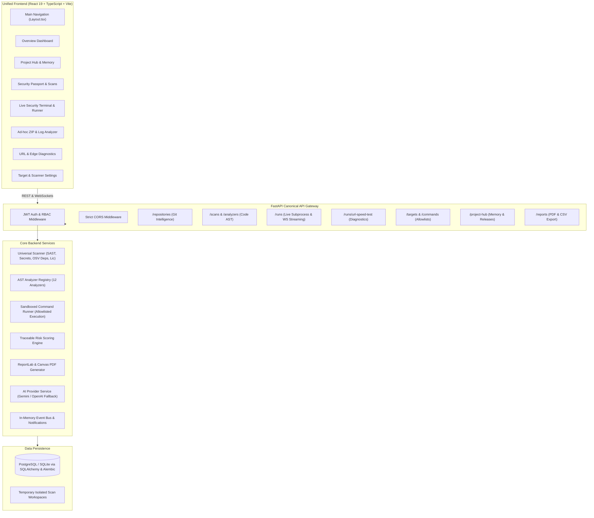
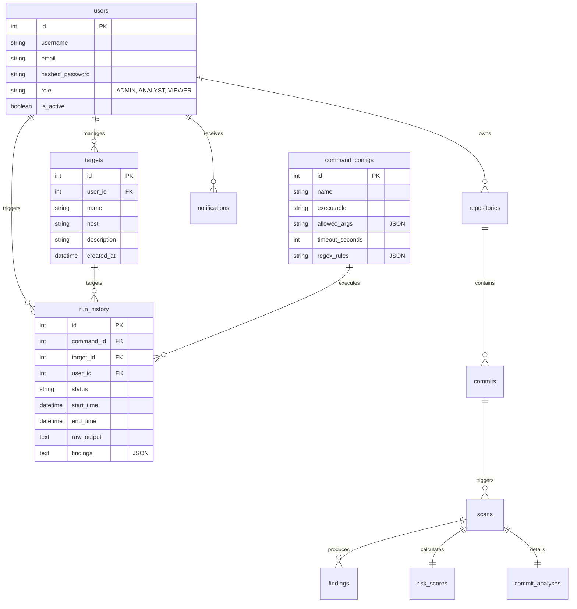

# Unified Application Architecture

## 1. Architectural Blueprint

The unified application integrates the repository intelligence, AST analyzers, and PR gate infrastructure of **Project B** with the live command-scanning engine, interactive terminal HUD, and network/log triage tools of **Project A**.

---

## 2. Request & Execution Flows

### 2.1 Repository Analysis & Commit Scanning Flow
1. **Trigger:** User registers a repository or background poller detects a new commit SHA on GitHub.
2. **Worker Execution:** `workers/scan_job.py` fetches commit tree into an isolated, safe temporary workspace.
3. **Multi-Engine Scan:**
   - `UniversalScanner` runs regex + AST scanners (detects hardcoded keys, high-entropy secrets, and SAST injection flaws).
   - `OSV API Batch Query` resolves dependencies declared in `package.json`, `requirements.txt`, etc., identifying known CVEs.
   - `Registry` executes active code analyzers (`ApiContractAnalyzer`, `DatabaseMigrationAnalyzer`, `CicdDeploymentAnalyzer`, etc.).
4. **Scoring & Normalization:** Findings are deduplicated using cryptographic fingerprints (`sha256(type + path + line)`), stored with foreign keys to the scan record, and `RiskScoreEngine` updates the repository risk posture.
5. **Notification:** Results are emitted via `EventBus` to notify connected clients.

### 2.2 Live Security Tool Execution Flow (WebSocket Streaming)
1. **Initiation:** Authenticated user selects a registered `Target` and approved `CommandConfig` in `/scanner`.
2. **Validation:** Backend verifies user permissions, validates target host against an RFC-compliant regex, and checks requested arguments against `CommandConfig.allowed_args`.
3. **Execution:** `CommandRunner` executes the executable without shell invocation (`shell=False`) under strict timeout limits.
4. **Streaming:** Process stdout/stderr chunks are forwarded in real time over WebSocket to the frontend terminal HUD.
5. **Pattern Analysis:** `OutputAnalyzer` matches regex rules on the fly, creating structured findings and writing the completed `RunHistory` to the database.

### 2.3 Ad-Hoc ZIP & Log Triage Flow
1. **Client Decompression:** The browser unzips the uploaded archive using `fflate` in chunks, ignoring binary assets, lockfiles, and `node_modules/`.
2. **Analysis Request:** Filtered text is sent to `/runs/analyze-manual`.
3. **Inspection:** Deterministic pattern recognition categorizes errors (e.g., prototype pollution, XSS, unhandled promises, leaked credentials).
4. **Remediation Advice:** Actionable guidance is generated locally; optional "Generate AI Fix" calls `AIProviderService` for detailed diff proposals.
5. **Export:** Reports can be exported to server-generated PDF or downloaded instantly as CSV/JSON.

---

## 3. Database Architecture & Relationships

---

## 4. Key Security Controls

1. **Strict Subprocess Containment:**
   - No `shell=True`.
   - Arguments must be exact matches from `CommandConfig.allowed_args`.
   - Target hostnames must match `^[a-zA-Z0-9.-]+$` (or IPv4/IPv6).
   - Timeouts enforce termination of hanging or unresponsive processes.
2. **Safe Archive Processing:**
   - Maximum archive extraction limit (500,000 characters).
   - Explicit exclusion of directory traversals (`..`), symbolic links, binary executables, and dependencies.
3. **AI Safety & Data Privacy:**
   - Backend keys never leave the server.
   - Code excerpts are sanitized of secrets prior to external AI prompt assembly.
   - Graceful deterministic fallbacks ensure core operations never depend on external AI availability.
